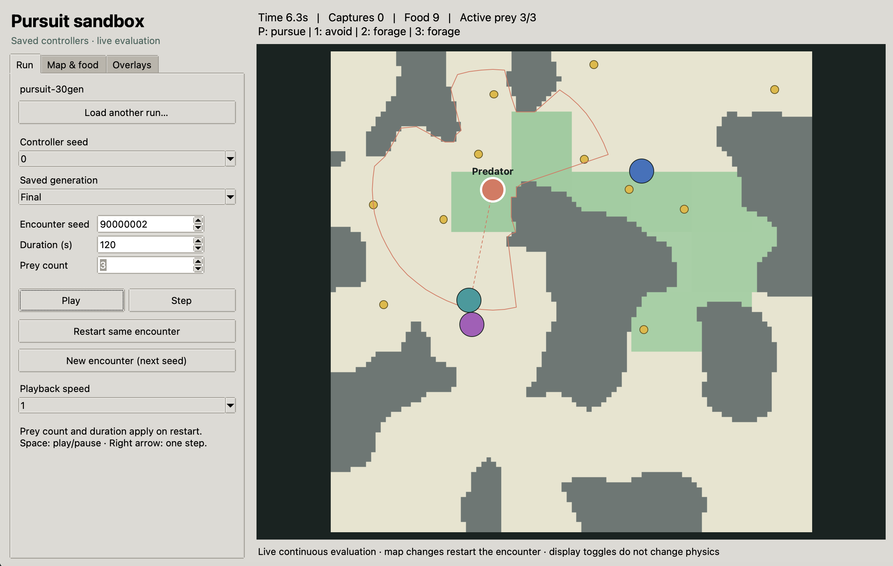

# Predator–Prey Evolution

Train predator and prey movement controllers, then explore their behavior in a
live interactive viewer. One predator pursues multiple prey that forage, evade,
and respawn. Evolution changes movement controllers; target priorities, sensing,
and collision rules are programmed. The viewer uses saved controllers and does
not train while playing.



## Setup

Run all commands from the repository root. Use Python 3.10 or newer with tkinter
support. The current Python viewer and training workflow do not require Godot.

**Windows — PowerShell**

```powershell
py -m venv .venv
.\.venv\Scripts\python.exe -m pip install -r requirements.txt
```

**macOS — Terminal**

```bash
python3 -m venv .venv
.venv/bin/python -m pip install -r requirements.txt
```

If you already have `.venv`, skip creating it. To check tkinter, run your virtual
environment's Python with `-m tkinter`; a small test window should open. If tkinter
is missing, install a Python distribution with Tk support and recreate `.venv`.

## Generate a sample and open the viewer

Saved runs live in `results/`, which Git ignores. A fresh clone or a pull on
another computer does not bring trained controllers with it. Generate this small
sample, or copy a compatible saved run from your other computer.

The sample uses an empty arena, one predator, three prey, and two generations.
It checks the complete workflow without needing a terrain file.

**Windows — PowerShell**

```powershell
.\.venv\Scripts\python.exe -u -m src.training --arena empty --respawn --prey-count 3 --generations 2 --seeds 1 --training-starts 1 --test-starts 2 --seconds 10 --replay-seconds 10 --output results/viewer-sample
.\.venv\Scripts\python.exe -m src.viewer results/viewer-sample
```

**macOS — Terminal**

```bash
.venv/bin/python -u -m src.training --arena empty --respawn --prey-count 3 --generations 2 --seeds 1 --training-starts 1 --test-starts 2 --seconds 10 --replay-seconds 10 --output results/viewer-sample
.venv/bin/python -m src.viewer results/viewer-sample
```

Wait for training to finish before opening the viewer. Training requires a new
output directory; use another name if `results/viewer-sample` exists. Reopening
the viewer uses the existing run and does not retrain.

For the commands below, `python` means your virtual environment's Python:
`.venv/bin/python` on macOS or `.\.venv\Scripts\python.exe` on Windows.

## Use the interactive viewer

```bash
python -m src.viewer results/viewer-sample --paused
```

- **Run:** choose a controller seed and saved generation, encounter seed, prey
  count, and duration. Restart repeats an encounter; New encounter changes its
  seed. Space plays or pauses; Right Arrow steps while paused.
- **Map & food:** select the training map or empty arena, generate terrain, or
  load an exported 96 × 96 terrain JSON. Changing maps restarts the encounter.
- **Overlays:** select one organism from the dropdown or click its body.
  Checkboxes show only its vision, route waypoints, final target, visited squares,
  trail, and label. Switching selection moves the indicators while preserving
  checkbox choices. Food and grid controls apply to the whole arena.

Playback speed and overlays do not change simulation physics. For comparisons,
keep the map, encounter seed, prey count, and other simulation settings fixed.
A controller trained in an empty arena may perform differently on complex terrain.

Omit the run argument to load the latest compatible run directly inside
`results/`. To transfer a run, copy its entire directory, including
`champions.json`, `instructions.json`, `terrain.json`, and `history.json` if
available. Older ecosystem comparison results are a different format and cannot
be opened in this viewer.

## Train a longer experiment

This starts fresh with 30 generations and three independent training seeds.
Each encounter lasts 30 simulated seconds. Training runs without the viewer;
progress prints in the terminal. Total runtime depends on your machine and settings.

```bash
python -u -m src.training --arena empty --respawn --prey-count 3 --generations 30 --seeds 3 --training-starts 4 --test-starts 16 --seconds 30 --replay-seconds 60 --eval-every 5 --output results/pursuit-30gen
python -m src.viewer results/pursuit-30gen --paused
```

More generations provide more opportunities for evolution, but do not guarantee
improvement. Compare saved generations in the viewer and inspect `outcomes.png`
and `measurements.csv`. Use `python -m src.training --help` for all options.
For terrain training, use `--arena terrain --terrain-map PATH_TO_TERRAIN.json`.

## Tests

```bash
python -m unittest discover -s tests/python -v
```

The viewer test briefly creates a desktop window, so run it in a desktop session.
Tests for the older Godot ecosystem also require Godot. If it is not found
on your system, copy `src/configs/config.json.example` to
`src/configs/config.json` and set the executable and project paths. Existing
`evolution/config.json` settings remain supported.

## Project layout

| Directory | Contents |
| --- | --- |
| `src/viewer/` | Interactive viewer |
| `src/training/` | Current pursuit training and basic ecosystem evolution |
| `src/simulation/` | Simulation, controllers, and shared foraging routines |
| `src/terrain/` | Terrain generation, collision, navigation, and preview launcher |
| `src/analysis/` | Evaluation, plots, replay rendering, and shared font loading |
| `src/experiments/` | Earlier experiment entry points |
| `src/configs/` | Default rules and optional local Godot configuration |
| `tests/python/`, `tests/godot/` | Python and Godot tests |
| `scripts/`, `*.tscn` | Godot scripts and scenes |
| `docs/` | Historical experiments and older workflow guides |
| `assets/` | Documentation images |
| `results/` | Generated runs, ignored by Git |

The old `evolution/pursuit_viewer.py` and `evolution/hybrid_pursuit.py` commands
remain as compatibility shortcuts. Shared vision and foraging modules retain
older experiment entry points alongside their simulation functions.

Historical workflows and development notes are preserved in
[Historical experiments](docs/HISTORICAL_EXPERIMENTS.md),
[Godot ecosystem](docs/ECOSYSTEM.md), and
[Numeric comparisons](docs/NUMERIC_EXPERIMENTS.md).

## Hunger and decision-tree feasibility pilot

```powershell
.\.venv\Scripts\python.exe -u -m src.experiments.hunger_tree_pilot --output results/hunger-tree-next
```

This separate diagnostic evolves prey decision trees from random initialization.
It uses one prey, a fixed scripted predator, an empty arena, and deterministic
navigation. The existing neural-controller experiments and viewer are unchanged.
Default budget: 3 seeds, 12 trees, 10 generations, 3 resampled training starts and
8 fixed held-out starts per seed. Fitness is mean first-life survival seconds,
ending at capture, starvation, or the 30-second limit. No food bonus, survival
shaping, capture penalty, or prey respawn is used. Food respawns with soft bias.

Hunger is an energy reserve: start 10 units, maximum 14, lose 1 per second, gain
6 per pellet. Thus one pellet supplies up to six seconds of additional reserve;
a prey that stays still without collecting food starves after ten seconds.
Captures and starvation are resolved within each physics timestep, including
food pickups before death. A simultaneous starvation/capture beats food pickup.

The controller sees normalized hunger, own position/velocity, visible object
lists with positions, relative positions, Euclidean/route distances and next
waypoints, and private visited-area/target/stuck memory. Only listed scalar
summaries in design.json are available as tree predicates. Leaves choose to
approach/move away from a visible food/predator object; select a reachable map
location by unvisited/oldest/random selection; or stay. Food/object rank and
Euclidean/route ordering are mutable. No visible target means stay, not a
programmed fallback. Actions are reconsidered every 0.5 seconds. Navigation,
waypoint following and the away-direction primitive remain supplied capabilities.

Selection uses two elites and tournaments of three; mutations change thresholds,
conditions, actions or bounded subtrees (maximum depth three). No baseline tree
is seeded into the population. Scripted-priority and stationary references share
held-out starts and are evaluated once. Initial means the training-selected
champion at generation zero, not the average random tree. Three seeds provide
only preliminary evidence. A fixed predator isolates feasibility, not co-evolution.

Outputs: outcomes.png, summary.json, per-encounter measurements.csv, trees.json,
readable seed-N-tree.txt, baseline-tree.txt, and design.json with the exact setup.
Open viewer.html directly for initial/evolved/scripted first-life replays with
hunger, actions and tree text; these are saved replays, not live training. They
use the first held-out start for each seed without selecting highlights. The
desktop viewer also loads these tree genomes (see below).

Open the hunger-tree experiment in the existing live desktop viewer:

```powershell
.\.venv\Scripts\python.exe evolution/pursuit_viewer.py results/hunger-tree-long-01
```

Controller seed and Saved generation select the tree, with Scripted baseline and
Stationary references also available. The Tree tab displays the selected program;
the main panel shows hunger reserve and current actions. Pause, Play, single-step,
speed, map generation/loading and visual overlays work for both tree and neural
runs. Tree runs use one prey and stop at capture, starvation or the chosen time
limit. Pressing Play after an ended life restarts the same encounter. There is no
prey respawn or training in this viewer mode. Changing duration or maps evaluates
the same tree under those new conditions. Initial food stays uniform as in the
experiment; food controls affect respawning pellets. Encounter seed is independent
of controller seed; held-out starts for controller seed N begin at 90000000+1000*N.
With no run argument the viewer chooses the newest compatible tree or neural run.
The standalone HTML viewer now starts paused and Play correctly restarts at the
end of a replay; its saved pages can be refreshed without retraining.
Optional --terrain-map FILE uses a saved 96x96 map; --no-predator isolates feeding.

## Small hunger-tree co-evolution pilot

```powershell
.\.venv\Scripts\python.exe -u -m src.experiments.hunger_coevolution --source results/hunger-tree-long-01 --output results/hunger-coevolution-next
```

Default: first three source prey seeds, six generations, six candidates per role,
two shared opponents and two fresh training starts per generation, six held-out
starts per seed. Source prey and mutated variants initialize identical co-evolution
and fixed-control populations. Predators start with a tree implementing the old
scripted pursuit/exploration strategy plus mutated variants. Both populations
update simultaneously. Navigation, empty arena, speeds, vision, food and hunger
are unchanged. Prey fitness remains survival; predator fitness is 2 - survival /
horizon only on capture, zero on starvation or timeout. No distance shaping is used.

Predators can approach/move away from visible prey, explore reachable map tiles,
stay, or continue the stored target. Observations include visible prey position,
velocity, route distance, own movement, visits and target/stuck history. Unseen
prey data are masked; prey hunger and food are not supplied to predators.

Reference evaluations hold the baseline predator or source prey fixed. Historical
matrices match saved predator/prey generations within each seed. Fresh held-out
starts begin at 200000000 + seed*1000. All test results are evaluation-only and do
not affect selection. Duplicate episodes are cached, including historical
same-generation pairings. The control matches prey population/generation budgets
and starting scenarios; total compute is not matched because co-evolution also
trains predators and samples multiple opponents. This is a feasibility pilot.

Open a completed paired run in the desktop viewer:

```powershell
.\.venv\Scripts\python.exe evolution/pursuit_viewer.py results/hunger-coevolution-pilot
```

Select the prey generation and predator generation independently. Prey training
condition switches between co-evolution and the fixed-predator control; switching
to the control selects the fixed baseline predator. Both programs appear in the
Tree tab. Encounter seed is independent of training seed; the first held-out
start for seed N is 200000000 + 1000*N. Outcomes, raw matchups, readable programs,
source anchors and the exact design are saved with the run.
